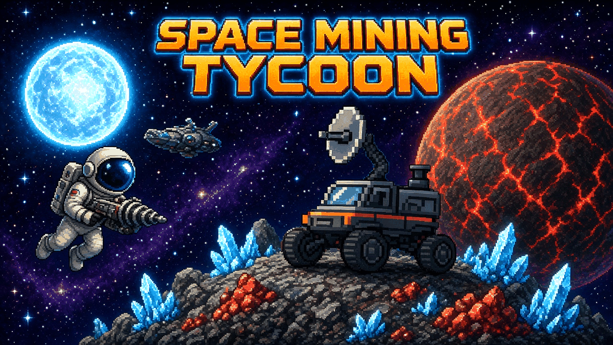
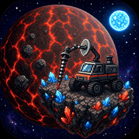
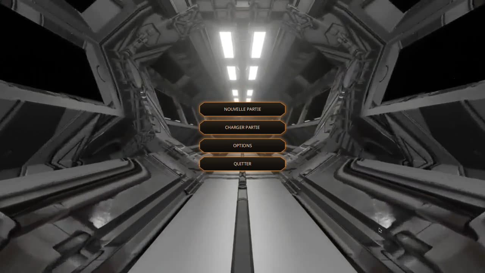
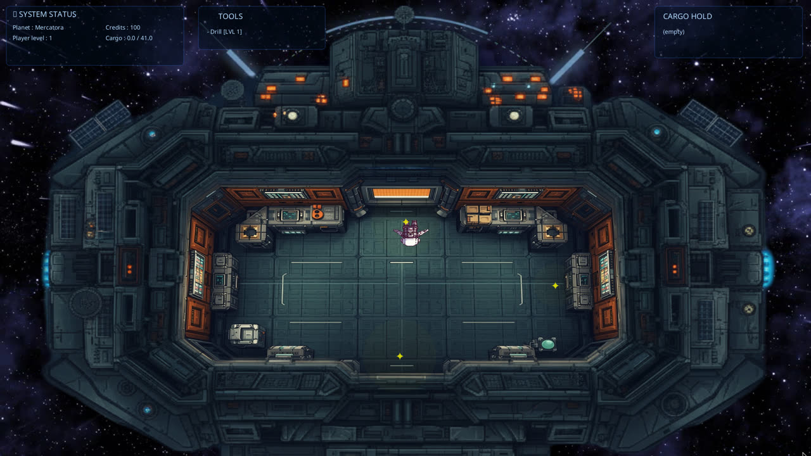
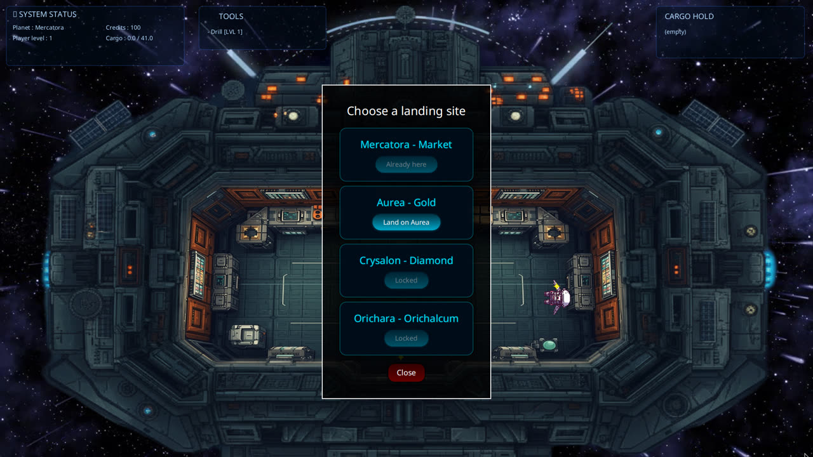
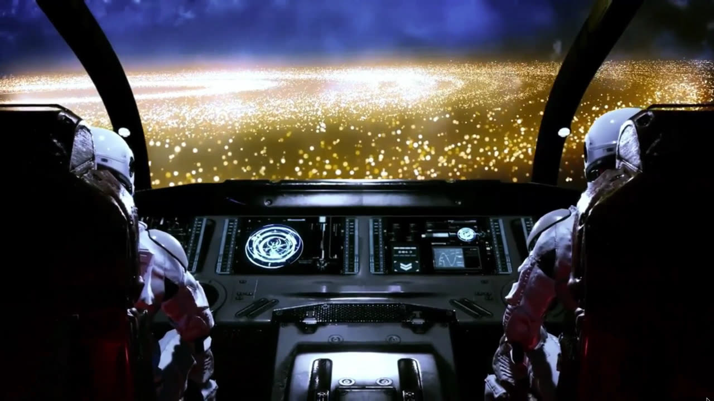
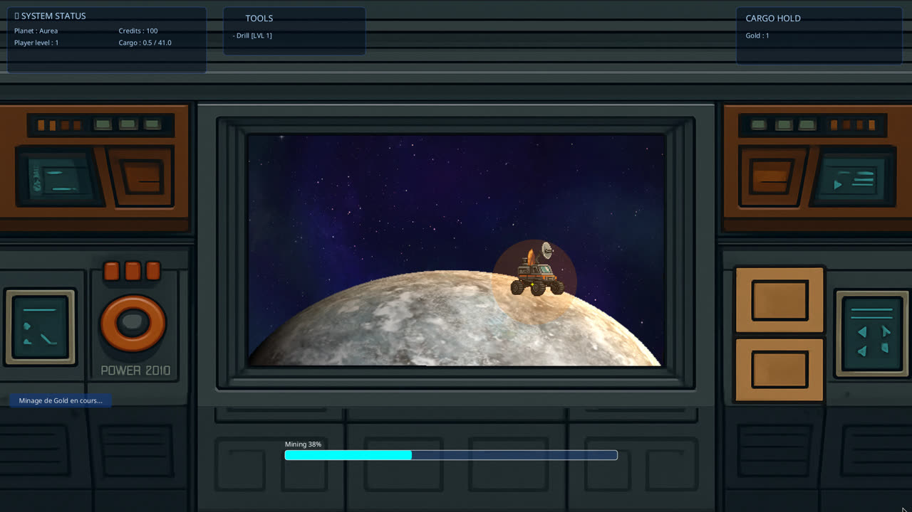
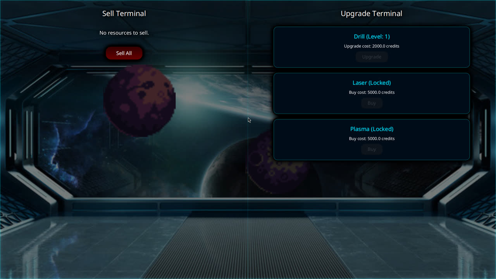
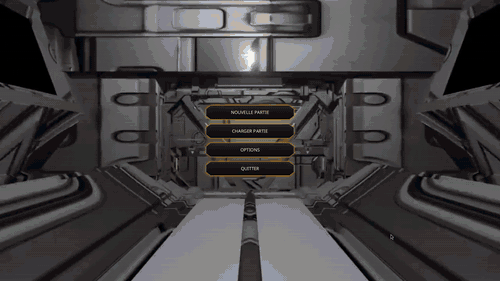

<p align="center"></p>

<p align="center">
  <a href="https://github.com/hugoegry"></a>
  &nbsp;
  <a href="mailto:hugo.egry@epitech.eu"></a>
  &nbsp;
  <a href="https://github.com/hugoegry?tab=stars"></a>
</p>

<h2 align="center">A 2D <strong>space mining tycoon</strong> built with <strong>Java &amp; JavaFX</strong>: walk around your ship, fly between planets, drive a rover to mine ore, sell it and upgrade your tools.</h2>
<br>

<div align="center">

<p align="center">
  
  
  
  
  
  
  
</p>

[Gameplay](#gameplay) • [Controls](#controls) • [Installation](#getting-started) • [Structure](#project-structure) • [Team](#contributors) • [Demo](#demo) • [License](#license)

</div>
<br>

---

## About The Project

<div align="center">

| **School Project** | **Epitech - T-JAV-501** | **2025-2026** |

</div>

### Project Context



This game was developed as a team project during our **Epitech** curriculum (Montpellier), in the Java module T-JAV-501. The goal was to design a complete object-oriented application in Java with a interface, a clean architecture (entities, screens, UI, world) and unit tests.

You play a space miner: starting with 100 credits and a basic drill, you travel from planet to planet, mine resources with your rover, sell them at the market station and invest in better tools to unlock richer planets.

<br clear="right">

---

## Gameplay

<p align="center"></p>

**1. Pick your ship.** Three ships with different trade-offs:

| Ship | In game | Strength |
|---|---|---|
| `Ship_Speed` | Vaisseau rapide | faster travel between planets |
| `Ship_Stock` | Transporteur | double cargo capacity (80 vs 40) |
| `Ship_Discount` | Discount | 10 % off tool purchases and upgrades |

**2. Walk around the ship.** The interior is a top-down room with three interactive zones: the **terminal** (travel), the **porthole** (planet view and mining) and the **door** (landing at the market).

<p align="center"></p>

**3. Travel.** The terminal lists the planets. Each one requires a research level: selling 50 resources raises your level (up to 3) and unlocks the next planet.

| Planet | Type | Resource | Tool needed |
|---|---|---|---|
| Mercatora | Market | - (sell & upgrade) | - |
| Aurea | Mining | Gold | Drill |
| Crysalon | Mining | Diamond | Laser |
| Orichara | Mining | Orichalcum | Plasma |

<p align="center">
  
  
</p>

**4. Mine.** Through the porthole, drive the rover along the planet surface to the ore deposit and start mining. Mining time depends on the planet difficulty and your tool level; the ore goes into your cargo hold.

<p align="center"></p>

**5. Sell and upgrade.** On Mercatora, the sell terminal buys your cargo and the upgrade terminal sells better tools (Drill upgrades, Laser, Plasma).

<p align="center"></p>

### Features

- Ship interior with physics-based movement (acceleration, friction, wall collisions)
- Four planets with their own video backgrounds and a travel cinematic
- Rover driven along a hand-edited path, with interactive mining zones and a progress bar
- Resource economy: price ranges, weight, cargo capacity
- Tools with levels (Drill, Laser, Plasma) and an upgrade shop
- HUD: system status, tools, cargo hold, notifications
- Save / load (`savegame.json`) and key rebinding in the options menu
- Windows portable build with a bundled Java runtime (`jpackage`)

---

## Controls

| Key | Action |
|---|---|
| `Z` `Q` `S` `D` | Move (AZERTY layout) |
| `E` | Interact (terminal, porthole, door, mining zone) |
| `Q` / `D` | Drive the rover (planet view) |
| `F2` | Save |
| `Esc` | Leave the planet view / back to the main menu (auto-save) |

Bindings can be changed in **Options**.

---

## Getting Started

### Play (Windows)

Download `SPACE-MINING-TYCOON-portable-win-1.0.zip` from the [Releases](../../releases) page, unzip it and run **`SPACE MINING TYCOON.exe`**. No Java installation needed, the runtime is bundled.

### From source

Requirements: **JDK 25** (JavaFX is fetched by Gradle).

```bash
git clone https://github.com/hugoegry/<repo>.git
cd <repo>
./gradlew run            # Windows: gradlew.bat run
```

Build the portable Windows version (run on Windows):

```bash
gradlew.bat packageWin   # -> build/dist/SPACE MINING TYCOON/ and the portable zip
```

---

## Project Structure

```
├── build.gradle                  Gradle build (JavaFX plugin, JaCoCo, jpackage tasks)
├── SpaceMining/
│   ├── src/
│   │   ├── Main.java             entry point
│   │   ├── screens/              MenuShell, GameScene, SettingsScene, ShipSelectionScene
│   │   ├── ui/                   HUD, SellMenu, UpgradeMenu, TravelMenu, VideoLayer
│   │   ├── entities/             Player, Ship, Ressource, Tool, Drill, Laser, Plasma
│   │   ├── ships/                Ship_Speed, Ship_Stock, Ship_Discount
│   │   ├── world/                Zone, Wall, planet/ (Planet, RoverController, PlanetView)
│   │   ├── game/GameState.java   global state and key bindings
│   │   ├── tools/                SaveManager, wall / path editors, video diagnostics
│   │   ├── utils/                Audio, Inventory, InteractiveZone, AppBrand
│   │   └── assets/               sprites, planets, videos, music, icon
│   └── test/                     JUnit 5 tests
└── .github/workflows/            CI (Gradle build + tests + coverage)
```

---

## Contributors

<div align="center">
<table>
  <tr><th>Avatar</th><th>Name</th><th>Role</th><th>GitHub</th></tr>
  <tr><td align="center"></td><td><b>Hugo Egry</b></td><td>Developer</td><td><a href="https://github.com/hugoegry">@hugoegry</a></td></tr>
  <tr><td align="center"></td><td><b>Loic Noro</b></td><td>Developer</td><td><a href="https://github.com/LoicEpitech">@LoicEpitech</a></td></tr>
  <tr><td align="center"></td><td><b>Rewann Tannou</b></td><td>Developer</td><td><a href="https://github.com/RewannTannou">@RewannTannou</a></td></tr>
</table>

<sub>Epitech Montpellier · T-JAV-501 · 2025-2026</sub>
</div>

---

## Demo

A real play session (about 68 s, shown at half speed): main menu, ship selection, the ship interior, travel to Aurea, the rover mining gold, then (from a prepared save with stocked cargo) selling at the market, upgrading the drill, reaching level 2 and flying to the newly unlocked Crysalon.

<p align="center"></p>

---

## License

This project is released under the **MIT License**.

Copyright (c) 2025-2026 **Hugo Egry**, **Loic Noro**, **Rewann Tannou**.

See the full text in [`LICENSE`](LICENSE).